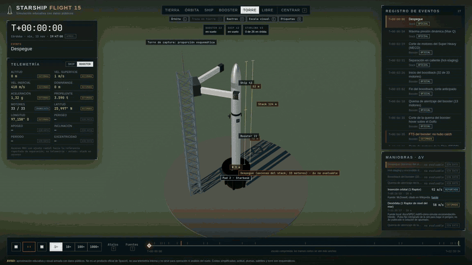
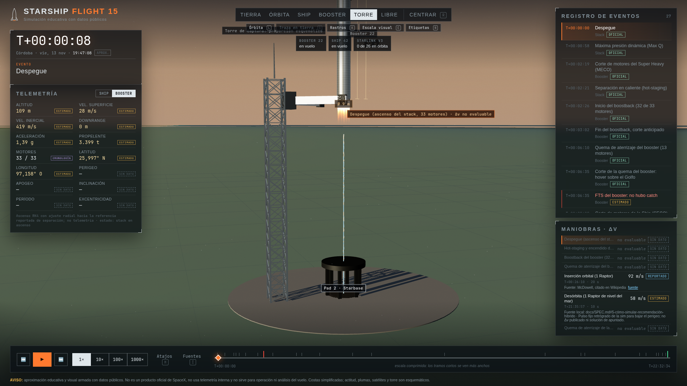
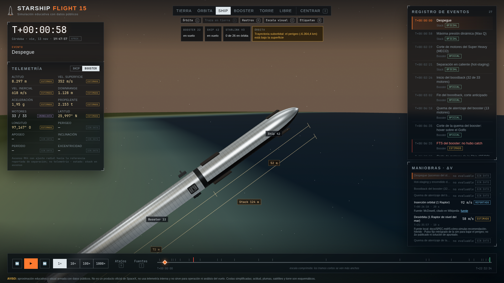
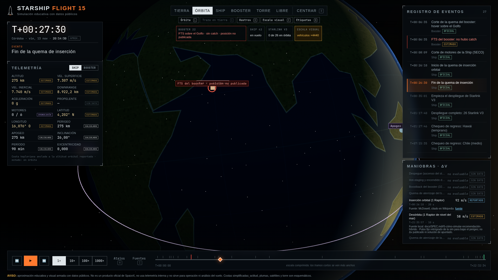
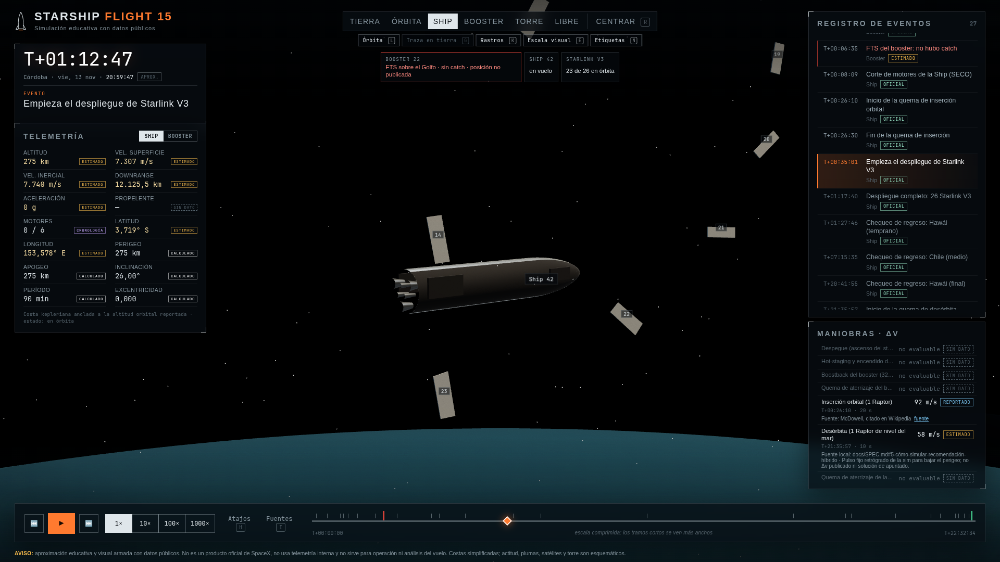

# Starship Flight 15 · Mission walkthrough

An interactive, unofficial fan simulation of the Starship Flight 15 test flight, built from public data and playable in your browser.

**This educational approximation is not an official SpaceX product, is not affiliated with SpaceX, and does not show internal telemetry.** Do not use it to operate vehicles or draw forensic conclusions about the flight.



## Features

- **Interactive cameras:** Earth, orbit, Ship, booster, tower, and free view, with zoom and recentering.
- **Playback:** 1×, 10×, 100×, or 1000× speed, a seek bar, and an event log.
- **The full mission:** from liftoff to the Ship catch at Pad 2, including activation of the booster's flight termination system (FTS) over the Gulf. The booster did not return to the tower.
- **Live osculating orbit,** with perigee and apogee calculated from position and velocity.
- **Deployment of 26 Starlink V3 satellites,** which stay in their own orbits as Ship returns.
- **Maneuvers with Δv,** where the model can calculate it.
- **Telemetry with sources and confidence labels** (official, reported, estimated, calculated, interpolated, or no data).

## Gallery

The Flight 15 simulation ends with Ship caught by the tower arms at Pad 2. The booster does not return: at T+00:06:35, it is over the Gulf when its engines shut down and the FTS activates.

**Liftoff from Pad 2.** T+00:00:08, tower camera.



**Maximum dynamic pressure (Max Q).** T+00:00:58, Ship camera.



**Hot staging.** T+00:02:23, Ship camera.


**Super Heavy boostback.** T+00:02:37, booster camera, 32 of 33 engines firing.


**Orbital insertion and live orbit.** T+00:27:30, orbit camera. Perigee and apogee are both at 275 km, anchored to a reference rather than predicted by the model.



**Starlink V3 deployment.** T+01:12:47, Ship camera, with 23 of 26 satellites already in orbit.



**Reentry.** T+22:29:33, Ship camera, at 11 km. At T+22:10:46, the simulation makes an explicitly marked scene cut, not a maneuver.


**Catch at Pad 2.** T+22:32:34, tower camera. The tower arms catch Ship.


## Controls

| Action | Control |
| --- | --- |
| Play or pause | `Space` |
| Speed: 1×, 10×, 100×, 1000× | `1` `2` `3` `4` (or `−` and `+`) |
| Previous / next event | `,` and `.`, or click an event in the log |
| Seek to a point in time | Drag the seek bar (the scale is compressed so shorter segments are wider) |
| Skip 10 s or 60 s | `←` `→` (hold `Shift` for 60 s) |
| Jump to liftoff or catch | `Home` / `End` |
| Camera | `T` Earth, `O` orbit, `S` Ship, `B` booster, `P` tower, `F` free view. `R` recenters the view |
| Ship or booster telemetry | Click the tabs or press `V` |
| Layers | `L` osculating orbit, `G` ground track, `K` trails, `E` visual scale, `N` labels |
| Sources and shortcuts | `I` and `H` |
| Mouse | Drag to orbit, scroll to zoom, right-drag to pan |

`E` changes only the *visual* scale of the vehicles, not their dimensions or dynamics.

To watch orbital insertion without waiting, select its start in the event log, switch to the **Orbit** camera, and play at 1×. Watch the perigee rise during the burn. To compare the two vehicles' final phases, jump first to FTS with the **Booster** camera, then to the catch with the **Tower** camera.

## Run locally

With Node.js and npm installed:

```bash
npm ci
npm run dev
```

Open the local address Vite prints. `npm ci` installs the versions in the lockfile; `npm install` also works. Run `npm test` for tests and `npm run build` to build the static site.

Installation requires npm packages. The app does not require external services, remote maps, or API keys.

## Versioning

Versions follow [Semantic Versioning](https://semver.org/spec/v2.0.0.html). `package.json` is the source of truth. Every release is a `vX.Y.Z` git tag. Each version bump goes in its own pull request, which updates `package.json` and [CHANGELOG.md](CHANGELOG.md) before the tag is created.

## Data and sources

The [timeline and parameters](data/flight15.json) include their sources. The [research report](docs/research.md) documents data gaps and provenance. The [validation report](docs/VALIDACION.md) quantifies corrections and limitations.

Every HUD value has a confidence label: **official**, **reported**, **estimated**, **calculated**, **interpolated**, or **no data**. Even an official event time is approximate, and it does not make the vehicle's position at that time official.

The FTS coordinates, actual propellant load, dry masses, and exact second of liftoff were not published. Design capacities are not measured loads. The vehicle datasheet lists 1,614 tf for Ship; adding the per-engine figures yields 1,575 tf. The simulation does not average them.

The clock follows approximate mission milestones rather than automatically detecting Max Q, engine ignitions, or the catch. The stack's ascent integrates gravity, thrust, propellant consumption, and drag. A radial adjustment brings the ascent through the reported separation altitude. The model's masses, Isp, Cd, and initial propellant load are assumptions, not measurements of B22 or S42. The booster's return and Ship's final segment are cinematic reconstructions.

Orbital insertion uses a final state anchored to a circular orbit at 275 km and an indirectly reported impulse of about 92 m/s. That is why ending at 275 km **is not a prediction**. The displayed perigee, apogee, period, and inclination are calculated from position and velocity. Deorbit uses an estimated impulse. Individual satellite release times and relative separation are not telemetry.

**At T+22:10:46, there is a scene cut, not a maneuver.** The illustrative orbit does not establish where the real Ship entered the atmosphere. To show the return to the Gulf, the reconstruction preserves altitude but changes position and velocity without inventing a reentry corridor. The [validation report](docs/VALIDACION.md) quantifies that discontinuity separately from the flight tolerances. Do not interpret it as engine Δv.

The map, altitude, and tower are schematic, as are the coastlines, vehicle attitude, exhaust plumes, and satellites.

## How it was built

The scene runs in the browser with [three.js](https://threejs.org/), [Vite](https://vite.dev/), and TypeScript.

It was built in a single `/deepwork` run in OpenCode using the repository's `test-astra-sol-2026-11-19` preset: GPT-6.2 Astra as orchestrator and GPT-6.2 Sol as fixer. The [evaluation notes](NOTES-EVAL.md) detail the stages, limitations, and test results.

[Specification](docs/SPEC.md) · [Research and data gaps](docs/research.md) · [Validation](docs/VALIDACION.md) · [Changelog](CHANGELOG.md) · [MIT License](LICENSE)
