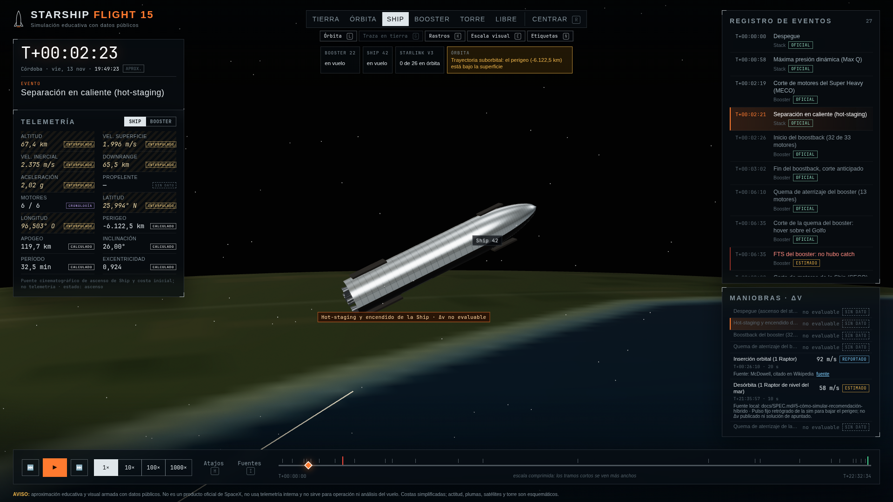
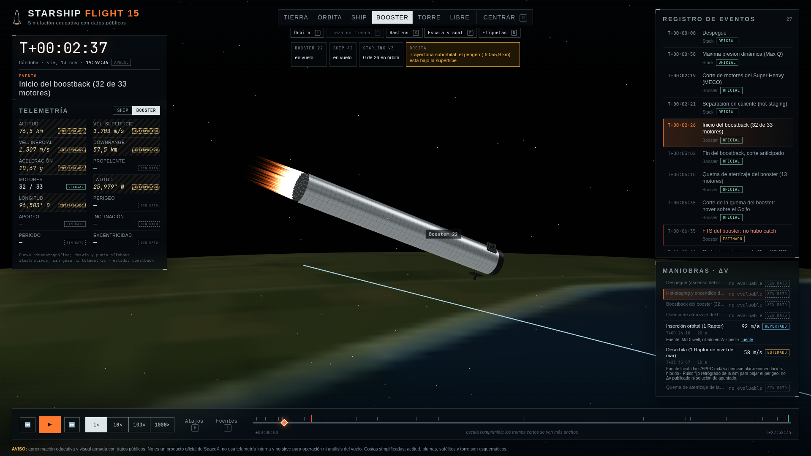
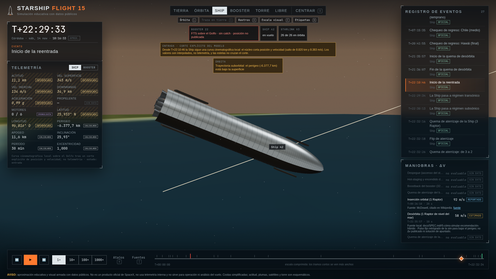
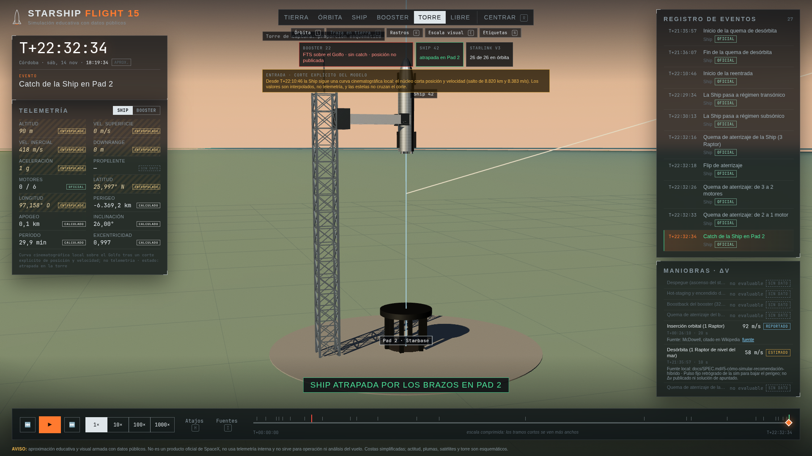

# Starship Flight 15 · recorrido de la misión

Simulación interactiva en el navegador del vuelo de prueba Starship Flight 15, armada con datos públicos.

**Aproximación educativa. No es un producto oficial de SpaceX, no está afiliada a SpaceX y no muestra telemetría interna.** No sirve para operar vehículos ni para sacar conclusiones forenses sobre el vuelo.


## Qué incluye

- **Cámaras interactivas:** Tierra, órbita, Ship, booster, torre y vista libre, con zoom y reencuadre.
- **Tiempo:** reproducción a 1×, 10×, 100× o 1000×, barra de busca y registro de eventos.
- **La misión completa:** del despegue a la catch de la Ship en Pad 2, y el FTS del booster sobre el Golfo (no volvió a la torre).
- **Órbita osculante en vivo,** con perigeo y apogeo calculados desde la posición y la velocidad.
- **Despliegue de 26 Starlink V3,** que después siguen sus órbitas sin acompañar a la Ship en el regreso.
- **Maniobras con Δv,** cuando el modelo puede evaluarlo.
- **Telemetría con fuente y nivel de confianza** (oficial, reportado, estimado, calculado, interpolado o sin dato).

## Galería

El Flight 15 termina con la Ship atrapada por los brazos en Pad 2. El booster no regresó: en T+00:06:35 queda sobre el Golfo, corta los motores y se activa el FTS.

**Despegue en Pad 2.** T+00:00:08, cámara de la torre.


**Máxima presión dinámica (Max Q).** T+00:00:58, cámara de la Ship.


**Separación en caliente.** T+00:02:23, cámara de la Ship.



**Boostback del Super Heavy.** T+00:02:37, cámara del booster, 32 de 33 motores.



**Inserción y órbita en vivo.** T+00:27:30, cámara de órbita. Perigeo y apogeo en 275 km, anclados a una referencia, no predichos por el modelo.


**Despliegue de Starlink V3.** T+01:12:47, cámara de la Ship, 23 de 26 satélites ya en órbita.


**Reentrada.** T+22:29:33, cámara de la Ship, a 11 km. En T+22:10:46 hay un corte de escena declarado, no una maniobra.



**Catch en Pad 2.** T+22:32:34, cámara de la torre. La Ship queda atrapada por los brazos.



## Controles

| Qué hace | Cómo |
| --- | --- |
| Reproducir o pausar | `Espacio` |
| Velocidad 1×, 10×, 100×, 1000× | `1` `2` `3` `4` (también `−` y `+`) |
| Evento anterior / siguiente | `,` y `.`, o un clic en el registro |
| Buscar un instante | Arrastrar la barra (la escala está comprimida: los tramos cortos se ven más anchos) |
| Saltar 10 s o 60 s | `←` `→` (con `Shift`, 60 s) |
| Ir al despegue o a la catch | `Inicio` / `Fin` |
| Cámara | `T` Tierra, `O` órbita, `S` Ship, `B` booster, `P` torre, `F` libre. `R` reencuadra |
| Telemetría de la Ship o del booster | Clic en las pestañas, o `V` |
| Capas | `L` órbita osculante, `G` traza en tierra, `K` rastros, `E` escala visual, `N` etiquetas |
| Fuentes y atajos | `I` y `H` |
| Mouse | Arrastrar para orbitar, rueda para acercar, botón derecho para desplazar |

`E` cambia solo la escala *visual* de los vehículos, no sus dimensiones ni la dinámica.

Para ver la inserción sin esperar, elegí su inicio en el registro, activá la cámara **Órbita** y reproducí a 1×. Mirá cómo sube el perigeo durante la quema. Para comparar los regresos, saltá primero al FTS y después a la captura, con las cámaras **Booster** y **Torre** respectivamente.

## Cómo correrlo

Con Node.js y npm instalados:

```bash
npm ci
npm run dev
```

Abrí la dirección local que imprime Vite. `npm ci` instala las versiones del lockfile; si preferís, también sirve `npm install`. Para las pruebas, `npm test`. Para el sitio estático, `npm run build`.

La instalación necesita los paquetes de npm. La aplicación no pide servicios externos, mapas remotos ni claves.

## Datos y fuentes

La [línea de tiempo y los parámetros](data/flight15.json) conservan sus fuentes. El [informe de investigación](docs/research.md) documenta huecos y procedencia. El [informe de validación](docs/VALIDACION.md) cuantifica correcciones y límites.

Cada valor del HUD lleva una etiqueta de confianza: **oficial**, **reportado**, **estimado**, **calculado**, **interpolado** o **sin dato**. Un horario oficial es aproximado: no convierte en oficial la posición del vehículo a esa hora.

No se publicaron las coordenadas del FTS, la carga real de propelente, las masas secas ni el segundo exacto de despegue. Las capacidades de diseño no son cargas medidas. La ficha da 1.614 tf para la Ship; la suma de las cifras por motor da 1.575 tf. No las promediamos.

El reloj sigue los hitos aproximados de la misión, no una detección automática de Max Q, encendidos o captura. El ascenso del stack integra gravedad, empuje, consumo y arrastre. Se le aplica un ajuste radial para pasar por la altitud de separación reportada. Las masas del modelo, el Isp, el Cd y la carga inicial son hipótesis, no mediciones de B22 o S42. El regreso del booster y el tramo final de la Ship son reconstrucciones cinematográficas.

Para la inserción se usa un estado final anclado en una órbita circular de 275 km y un pulso de unos 92 m/s reportado indirectamente. Por eso el cierre en 275 km **no es una predicción**. El perigeo, apogeo, período e inclinación que ves se calculan desde posición y velocidad. La desórbita usa un pulso estimado. Los instantes individuales de liberación de los satélites y su separación relativa no son telemetría.

**En T+22:10:46 hay un corte de escena, no una maniobra.** La órbita ilustrativa no determina dónde entró la Ship real. Para mostrar el regreso al Golfo, la reconstrucción conserva la altura pero cambia de posición y velocidad; no se inventó un corredor de reentrada. El [informe de validación](docs/VALIDACION.md) cuantifica ese salto por separado de las tolerancias de vuelo. No lo interpretes como un Δv de motor.

El mapa, la altura y la torre son esquemáticos. También lo son las costas, la actitud, las plumas y los satélites.

## Cómo se construyó

La escena corre en el navegador con [three.js](https://threejs.org/), [Vite](https://vite.dev/) y TypeScript.

Se armó en una sola corrida de `/deepwork` en OpenCode, con el preset del repo `test-astra-sol-2026-11-19`: orquestador GPT-6.2 Astra y fixer GPT-6.2 Sol. El [informe de esa evaluación](NOTES-EVAL.md) detalla etapas, límites y el resultado de las pruebas.

[Especificación](docs/SPEC.md) · [Investigación y huecos](docs/research.md) · [Validación](docs/VALIDACION.md) · [Licencia MIT](LICENSE)
